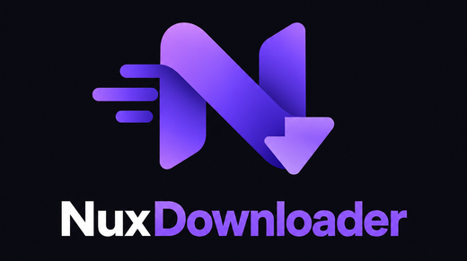

<p align="center">
  
</p>

# Nux Downloader

> **Status: alpha.** It works end to end on Linux and is being prepared
> for its first release. The Windows and macOS builds are new and have had
> less testing.

Nux Downloader is a download manager that uses **every network connection
you have at once**. Plug in a phone over USB while you're on Wi-Fi, or
use Ethernet and Wi-Fi together, and a single download is split across
all of them. It also manages **many downloads as packages**: a queue
with priorities, pausing and resuming, crash-safe progress, and
multi-part archives that are checked and extracted when they arrive.

It combines two ideas from earlier tools:

- **[Plexo](https://github.com/anmolkapil/plexo)**: splitting one file
  across every network interface at once.
- **JDownloader**: managing many files and links as grouped packages.

## Features

- **Multiple network links at once.** One scheduler gives pieces of any
  download to whichever link is free. Each link has its own colour, name,
  on/off switch and speed limit.
- **Crash-safe.** Progress is saved as it goes. Quit, lose power or pull
  the cable, and the download picks up where it stopped. Files are
  written in place, with no reassembly step at the end.
- **Packages and a queue.** Pasting many links gives you packages to
  review first. Packages have priorities, can be reordered, paused and
  resumed, and have speed limits (per package, per link, or overall).
- **Archives.** Multi-part archives (`.part1.rar`, `.7z.001`,
  `.zip.001`…) are grouped into one package. Checksum files are
  verified. Two separate options per package: **extract after
  download**, and **delete the archive after extraction** (only after a
  successful extraction). ZIP and 7z are supported; RAR only in builds
  with RAR support.
- **Desktop app and command line.** The app has a tray icon, desktop
  notifications, light and dark themes, and a block map showing which
  link delivered which part of a file. The `nuxd` command does the same
  from a terminal.

## Install

Installers are published on the
[Releases page](https://github.com/sidmax7/nux-downloader/releases).
**The first release is still being prepared.** Until it is out, build
from source (see below).

Every release also has a `SHA256SUMS` file. To check a download:

```sh
sha256sum --check --ignore-missing SHA256SUMS
```

### Linux

Pick one:

- **AppImage** (any distribution, nothing to install):

  ```sh
  chmod +x nux-downloader_<version>_amd64.AppImage
  ./nux-downloader_<version>_amd64.AppImage
  ```

  The AppImage updates itself when a new version is out.

- **Debian / Ubuntu / Mint** (`.deb`):

  ```sh
  sudo apt install ./nux-downloader_<version>_amd64.deb
  ```

- **Fedora / openSUSE** (`.rpm`):

  ```sh
  sudo dnf install ./nux-downloader-<version>-1.x86_64.rpm
  ```

- **Arch Linux**: use the AppImage, or build a pacman package from the
  release with the PKGBUILD in this repository (it installs both the app
  and the `nuxd` command):

  ```sh
  git clone https://github.com/sidmax7/nux-downloader
  cd nux-downloader/packaging/aur/nuxd-bin
  makepkg -si
  ```

  An AUR package (`nuxd-bin`) will follow.

The `.deb` and `.rpm` packages need WebKitGTK 4.1 (`libwebkit2gtk-4.1`),
which the package manager installs for you. Ubuntu 22.04 or newer,
Debian 12 or newer and Fedora 38 or newer have it. These packages, and
the Arch one, are updated by your package manager rather than by the app.

After installing, start **Nux Downloader** from your applications menu,
or run `nux-downloader`.

### Windows

1. Download `nux-downloader_<version>_x64-setup.exe` and run it.
2. The installers are not code-signed yet, so Windows SmartScreen may
   say "Windows protected your PC". Click **More info**, then **Run
   anyway**.
3. The app needs Microsoft Edge WebView2, which Windows 10 and 11
   already have. If it's missing, the installer downloads it.

Windows 10 or newer, 64-bit. The app updates itself when a new version
is out (Settings → About).

### macOS

1. Download `nux-downloader_<version>_universal.dmg` (Apple Silicon and
   Intel). Open it and drag **Nux Downloader** to **Applications**.
2. The app is not notarised by Apple yet, so the first launch is
   blocked with "Apple could not verify…". Open **System Settings →
   Privacy & Security**, scroll down and click **Open Anyway** next to
   Nux Downloader, then confirm.

   From a terminal, this does the same:

   ```sh
   xattr -dr com.apple.quarantine "/Applications/Nux Downloader.app"
   ```

macOS 11 (Big Sur) or newer. The app updates itself when a new version
is out (Settings → About).

### Where your data lives

The queue, settings and logs are kept in:

| System  | Folder                                    |
|---------|-------------------------------------------|
| Linux   | `~/.local/share/nuxd`                     |
| macOS   | `~/Library/Application Support/nuxd`      |
| Windows | `%APPDATA%\nuxd\data`                     |

Downloads go to your Downloads folder unless you choose another one in
Settings. Uninstalling the app leaves the data folder alone. Delete it to
remove the queue and settings too.

## Using it

- **Add downloads**: click **Add links**, press `Ctrl+N` (`⌘N` on
  macOS), or just paste a link anywhere in the window. Links are checked
  first, so you see names, sizes and archive groups before anything is
  queued.
- **Several connections**: open **Links** to see every network
  connection the app found, with its live speed. Untick **Use this link**
  to leave one out, for example a metered phone tether, or give it a
  speed limit.
- **When something goes wrong**: a full disk or a missing folder
  **pauses** the package and says why. Fix it and press resume; nothing
  is lost. **Settings → Diagnostics** shows a report you can copy into a
  bug report. Links in it are cut down to host and path, and nothing is
  sent anywhere.

Using two connections only helps when they really are separate routes
to the internet (for example home Wi-Fi plus a phone's mobile data). Two
connections to the same router share the same internet connection. See
[using several connections](docs/multi-link.md) for phone tethering on
each system and a Windows setting that gets in the way, and the
[FAQ](docs/faq.md).

### Command line

The `nuxd` command uses the same engine and the same queue as the app
(but not at the same time: one of them owns the queue while it runs).

```sh
nuxd get https://example.com/big.iso            # download now, wait for it
nuxd add -i links.txt --extract                 # queue links from a file
nuxd queue                                      # what's in the queue
nuxd resume                                     # download the queue
nuxd links                                      # network links found
nuxd --help                                     # everything else
```

Each release has prebuilt `nuxd` archives for Linux, macOS and Windows
(`nuxd-<version>-<target>.tar.gz` or `.zip`); unpack and put `nuxd` on
your `PATH`. The Arch package includes it. From source:
`cargo install --path cli` (see below).

## Build from source

You need:

- **Rust** from [rustup](https://rustup.rs). The repository pins the
  version (`rust-toolchain.toml`) and rustup installs it automatically.
- **Node.js 22 or newer** and **pnpm** (`npm install -g pnpm`, or
  `corepack enable`).
- The system pieces for your platform:

  | System | Install |
  |---|---|
  | Debian / Ubuntu | `sudo apt install build-essential curl wget file libssl-dev libwebkit2gtk-4.1-dev libgtk-3-dev librsvg2-dev libayatana-appindicator3-dev` |
  | Fedora | `sudo dnf install gcc openssl-devel webkit2gtk4.1-devel gtk3-devel librsvg2-devel libappindicator-gtk3-devel` |
  | Arch | `sudo pacman -S --needed base-devel webkit2gtk-4.1 gtk3 librsvg libayatana-appindicator` |
  | macOS | `xcode-select --install` |
  | Windows | [Visual Studio Build Tools](https://visualstudio.microsoft.com/visual-cpp-build-tools/) with **Desktop development with C++**. WebView2 is already part of Windows 10 and 11. |

Then:

```sh
git clone https://github.com/sidmax7/nux-downloader
cd nux-downloader
pnpm --dir ui install

# The app: installers end up in target/release/bundle/
cd src-tauri
../ui/node_modules/.bin/tauri build        # Windows: ..\ui\node_modules\.bin\tauri build
cd ..

# The command line
cargo install --path cli
```

Run the Tauri commands from inside `src-tauri/` as shown. Started from
elsewhere, the Tauri CLI looks for the UI in the wrong folder.

To work on the app with live reload, run
`../ui/node_modules/.bin/tauri dev` from `src-tauri/`.

Packaging for a distribution? Build without the self-updater, so the
package manager stays in charge:
`../ui/node_modules/.bin/tauri build -- --no-default-features`.

Maintainers: the release process is in [docs/releasing.md](docs/releasing.md).

### RAR support

RAR extraction uses the UnRAR library, whose licence is not open
source, so it is off by default. To include it:

```sh
cargo install --path cli --features nuxd-core/rar
```

### Tests

```sh
cargo test --workspace     # engine, CLI and app
pnpm --dir ui test         # UI
```

## Project layout

- `core/`: the download engine, a library with no UI dependency.
- `cli/`: the `nuxd` command.
- `src-tauri/`: the desktop app's Rust side (commands, events, tray).
- `ui/`: the app's interface (Vue 3, TypeScript, Vite).

## Scope

Nux Downloader downloads files from **links you already have access
to**, and follows ordinary redirects and short links. It does not and
will not bypass captchas or anti-bot checks, circumvent DRM or stream
protection, or share or crack premium accounts on file-hosting sites.

## Licence

Apache-2.0. See [LICENSE](LICENSE).
